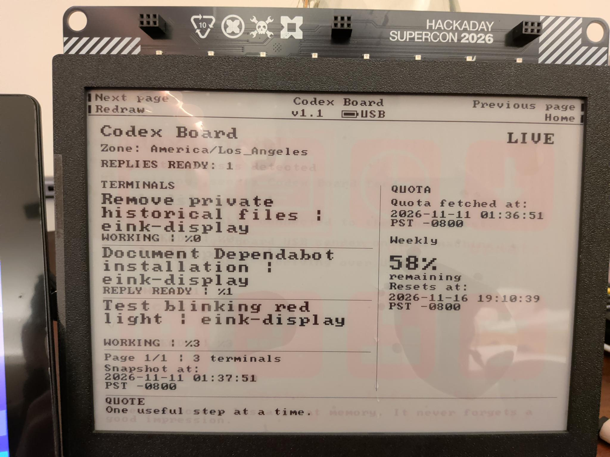
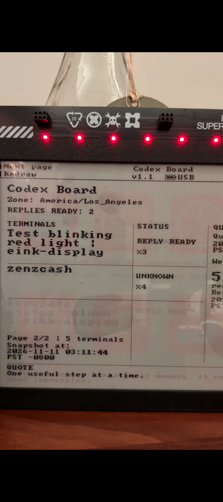

# Codex Board

I built Codex Board to turn my Hackaday Supercon 2026 Billboard Badge
into a desk display for my Codex terminal sessions. I can glance at it
to see which sessions are working, which have a reply ready, and which
need my input or approval.

  
  

## What I added

- An e-paper dashboard with one row per tmux pane, Codex quota and reset
  times, and a footer that alternates between a quote and a joke.
- A red LED alert when a session needs attention. The screen keeps the
  alert visible until the request clears.
- A Python collector that runs beside my Codex terminals. It uses tmux
  pane titles for session status and my existing Codex login for quota.
- A USB sender that delivers updates to the badge. There is also an
  experimental local Wi-Fi feed.

## Try it

You’ll need the 2026 Billboard Badge, the Codex Board firmware, and a
computer running Codex in tmux. Start with the USB setup in the
[build and setup guide](../../tools/codex_board/README.md).

## Credits

Codex Board runs on [Badge OS by yigitabi5444](https://github.com/yigitabi5444/supercon26-badge-os).
Badge OS provides the launcher, display driver, and base firmware.
